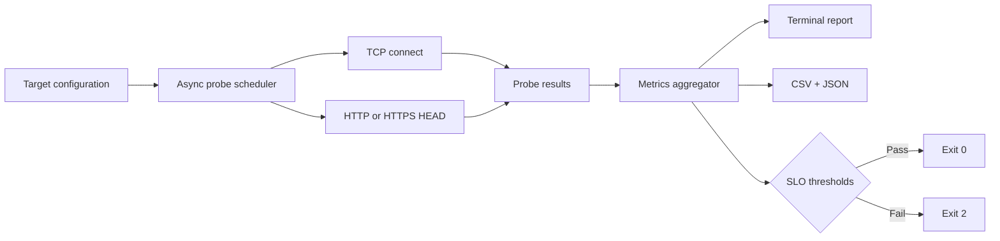

<div align="center">

# 📡 Network Latency Monitor

### Make every millisecond observable.

**Concurrent TCP and HTTP(S) health checks · Availability and percentile latency · CI-friendly network diagnostics**


</div>

---

A zero-runtime-dependency Python observability CLI for diagnosing network services and measuring their responsiveness. Monitor **multiple endpoints concurrently**, capture actual connection and response timings, calculate **p50/p95/p99**, estimate **jitter**, and export structured reports.

Designed for engineering workstations, local infrastructure checks, deployment smoke tests, and lightweight monitoring jobs.

## ✨ Features

| Capability | What it provides |
| :-- | :-- |
| ⚡ Concurrent checks | Async probes across multiple targets per sampling round |
| 🛜 Protocol coverage | TCP connection checks, HTTP and HTTPS HEAD requests |
| 📈 Network statistics | Availability, mean, minimum, maximum, p50/p95/p99 latency, jitter |
| 🎯 Quality gates | Nonzero exit code when availability or latency thresholds are violated |
| 📦 Reports | Machine-readable CSV samples and JSON summaries |
| 🔒 Secure HTTPS | Standard Python certificate verification and SNI |
| 🧪 Local tests | Deterministic tests using local asyncio servers |
| 🚀 CI | GitHub Actions across supported Python versions |
| 🧰 Packaging | Installable CLI command, `netwatch` |

## 🏗️ How it works



## 🚀 Quick start

Requires Python 3.10 or later.

```bash
git clone https://github.com/kasranonahal/network-latency-monitor.git
cd network-latency-monitor
python -m pip install -e .
```

### 1. Measure a single service

```bash
netwatch --host example.com --port 443 --count 10 --interval 0.5
```

### 2. Check an HTTPS endpoint

```bash
netwatch --host example.com --protocol https --port 443 --path / --count 10
```

### 3. Monitor multiple targets concurrently

```bash
netwatch --config config.example.json --count 20 --interval 1 \
  --csv samples.csv --json report.json
```

### 4. Use as a deployment quality gate

```bash
netwatch --host example.com --protocol https --min-availability 99 \
  --max-p95 500 --count 30
```

Exit code **0** means the configured thresholds passed; **2** means at least one threshold failed. Without thresholds, the command reports observations rather than enforcing a policy.

## 📊 Metrics explained

- **Availability**: fraction of successful probes, where TCP connected or HTTP returned a 2xx/3xx status.
- **Latency**: monotonic elapsed time for TCP connection; for HTTP(S), connection through response status headers.
- **p95 / p99**: interpolated sample percentiles, useful for highlighting tail latency.
- **Jitter**: mean absolute difference between consecutive *successful* latency samples, in milliseconds. This is an application sampling metric, not RTP jitter.
- **Errors**: timeout, connectivity failures, unexpected status codes, or TLS verification failure.

**Important:** These results are **not ICMP ping**, end-to-end browser page load time, or packet-loss measurements. DNS resolution and TLS negotiation are included in the elapsed time for applicable probes. Small sample sets cannot support reliable SLO conclusions; increase samples and run repeated measurements.

## 🗂️ Repository structure

```text
netwatch/
  __init__.py          # Package version
  monitor.py           # Async network probes and metrics
  cli.py               # CLI, config parsing, reporting and quality gates
tests/
  test_netwatch.py     # TCP/HTTP tests and metric assertions
  test_monitor.py      # Original compatibility tests
.github/workflows/
  ci.yml               # Multi-version Python CI
config.example.json    # Example targets
monitor.py             # Legacy CLI entry point
pyproject.toml         # Editable package installation
LICENSE
```

## 🧪 Testing

```bash
python -m pip install -e . pytest
pytest -q
```

CI runs the suite across Python 3.10, 3.11, 3.12, and 3.13. Tests run against loopback sockets, not external production hosts.

## 🔭 Roadmap

- [ ] Prometheus metrics exporter and Grafana dashboard
- [ ] Historical SQLite or time-series storage
- [ ] Scheduled polling and alert rules
- [ ] DNS-specific probes and breakdown of connect/TLS/TTFB
- [ ] Container image and Kubernetes readiness deployment examples
- [ ] IPv4/IPv6 controls and optional proxy configuration

## 🔍 Engineering references

Design ideas were informed by the mature monitoring ecosystem, particularly [Prometheus Blackbox Exporter](https://github.com/prometheus/blackbox_exporter). This project is an independent, intentionally smaller implementation, not a fork and not feature-equivalent.

## License

MIT. See [LICENSE](LICENSE).
